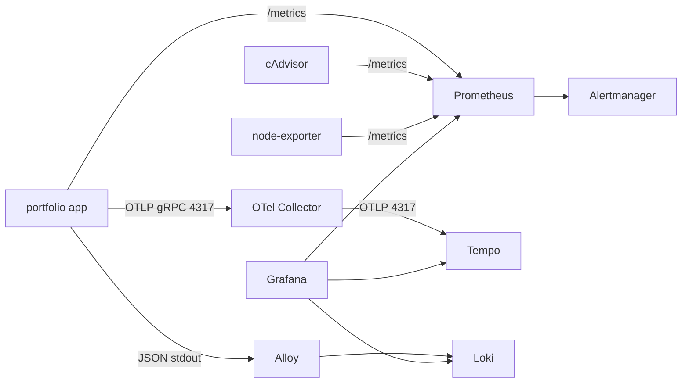

# Observability on minikube

Adds metrics, alerting, logs and traces on top of the app + PostgreSQL deployment, behind Grafana
and Alertmanager.

| Component | Image | Purpose |
| --- | --- | --- |
| `prometheus` | `prom/prometheus:v3.15.1` | Scrapes `/metrics`, evaluates alert rules, 24h retention |
| `alertmanager` | `prom/alertmanager:v0.28.1` | Receives alerts from Prometheus, groups/inhibits, Telegram delivery |
| `cadvisor` | `gcr.io/cadvisor/cadvisor:v0.55.1` | Container CPU/memory/network/filesystem metrics (DaemonSet) |
| `node-exporter` | `prom/node-exporter:v1.12.1` | Host CPU/memory/filesystem/network metrics (hostNetwork DaemonSet) |
| `loki` | `grafana/loki:3.7.9` | Log storage, 7-day retention |
| `alloy` | `grafana/alloy:v1.21.3` | Tails pod logs through the Kubernetes API and pushes to Loki |
| `tempo` | `grafana/tempo:3.1.1` | Trace storage |
| `otel-collector` | `otel/opentelemetry-collector-contrib:0.164.0` | OTLP gRPC/HTTP receiver, forwards traces to Tempo |
| `grafana` | `grafana/grafana:13.2.5` | Dashboards and Explore, datasources provisioned from ConfigMaps |



Resource requests total ~490m CPU / ~1024Mi memory; limits ~2.9 cores / ~2.3Gi. That fits the default
3.8 GiB minikube (the app + PostgreSQL also run there), but it is close. Grafana is the hungriest
component: it needs ~250Mi just to boot and registers ~50 plugins, so it gets a 512Mi memory limit, a
1-core CPU limit and a 5-minute startup probe. If pods still get `OOMKilled`, raise the minikube
memory or lower the limits in the manifests.

## 1. Deploy

```bash
cd /home/nam/portfolio
chmod +x scripts/k8s-monitoring-deploy.sh
./scripts/k8s-monitoring-deploy.sh
```

This script:

1. Creates the `observability` namespace.
2. Creates the `grafana-admin` secret with a random password (reused on re-runs).
3. Creates the `alertmanager-telegram` secret from `TELEGRAM_BOT_TOKEN` or
   `secrets/telegram_bot_token` (reused on re-runs; a placeholder is used with a warning if neither
   is set).
4. Applies `deploy/k8s/observability` (Prometheus, Alertmanager, cAdvisor, node-exporter, Loki, Tempo,
   OTel Collector, Alloy, Grafana).
5. Re-applies the app manifests so the pod gets the new `OTEL_EXPORTER_OTLP_ENDPOINT` and the
   `portfolio.portfolio.svc.cluster.local` scrape host, then restarts the app.
6. Waits for all workloads and prints the Grafana credentials.

Add the hosts entry once:

```bash
echo "$(minikube ip) grafana.local alertmanager.local portfolio.local" | sudo tee -a /etc/hosts
```

Access:

- Grafana: <http://grafana.local>
- Alertmanager: <http://alertmanager.local> (no authentication; keep it local/VPN)
- Prometheus UI: `kubectl -n observability port-forward svc/prometheus 9090:9090` → <http://localhost:9090>

Recover the Grafana password at any time:

```bash
kubectl -n observability get secret grafana-admin \
  -o jsonpath='{.data.admin-user}'; echo
kubectl -n observability get secret grafana-admin \
  -o jsonpath='{.data.admin-password}' | base64 -d; echo
```

> `GF_SECURITY_ADMIN_PASSWORD` is only applied when Grafana initializes its database. Changing the
> secret later does not change the existing login. Reset it with:
> `kubectl -n observability exec deploy/grafana -- grafana cli admin reset-admin-password 'new-password'`

Alertmanager reads the Telegram bot token from the `alertmanager-telegram` Secret via
`bot_token_file`; the token is never in the ConfigMap or Git. Set or rotate it with:

```bash
kubectl -n observability create secret generic alertmanager-telegram \
  --from-literal=telegram_bot_token='<telegram-bot-token>' \
  --dry-run=client -o yaml | kubectl apply -f -
kubectl -n observability rollout restart deployment/alertmanager
```

The destination chat ID is configured in `config/alertmanager.yml`. Alertmanager still starts with a
placeholder token, but Telegram delivery fails until a real token is set.

## 2. Verify

Pods and volumes:

```bash
kubectl -n observability get pods,pvc,svc,ingress
kubectl -n observability get pods --field-selector=status.phase!=Running
```

Prometheus targets (all jobs should be `up`):

```bash
kubectl -n observability port-forward svc/prometheus 9090:9090 >/dev/null &
curl -s http://127.0.0.1:9090/api/v1/targets | python3 -c '
import json,sys
for t in json.load(sys.stdin)["data"]["activeTargets"]:
    print(f"{t[\"labels\"][\"job\"]:16} {t[\"health\"]:8} {t.get(\"lastError\",\"\")}")
'
```

Expected jobs: `prometheus`, `alertmanager`, `portfolio-app`, `node-exporter`, `cadvisor`, `loki`,
`tempo`, `otel-collector`.

Alertmanager health and alerts:

```bash
kubectl -n observability port-forward svc/alertmanager 9093:9093 >/dev/null &
curl -s http://127.0.0.1:9093/-/ready
curl -s http://127.0.0.1:9093/api/v2/alerts | head -c 500
```

The app's own metrics endpoint (checks the Host allowlist fix):

```bash
kubectl -n portfolio port-forward svc/portfolio 8080:80 >/dev/null &
curl -s http://127.0.0.1:8080/metrics | head
```

Generate some traffic so there is something to see in all three signals:

```bash
for i in $(seq 1 30); do curl -fsS -o /dev/null http://portfolio.local/projects; done
```

Then in Grafana:

- **Dashboards → Portfolio**: `Portfolio Service Overview`, `Portfolio - cAdvisor / Containers`,
  `Portfolio - Node Exporter / Host`. The host dashboard uses `job="node-exporter"`.
- **Explore → Loki**: `{service="portfolio-app"}` (or `{namespace="portfolio"}`).
- **Explore → Tempo**: query type **Search**, service name `portfolio-app`. Click a trace; the
  "Logs for this span" link uses the Loki datasource.

For alerts, open <http://alertmanager.local> to see active alerts, the notification log and silences.
Prometheus also shows the same rules under **Status → Rules** and **Alerts**.

Loki/Tempo without Grafana:

```bash
kubectl -n observability port-forward svc/loki 3100:3100 >/dev/null &
curl -s http://127.0.0.1:3100/loki/api/v1/labels

kubectl -n observability port-forward svc/tempo 3200:3200 >/dev/null &
curl -s 'http://127.0.0.1:3200/api/search?tags=service.name%3Dportfolio-app' | head -c 500
```

`/ready` on each component:

```bash
kubectl -n observability exec deploy/grafana -- wget -qO- http://127.0.0.1:3000/api/health || true
kubectl -n observability logs deploy/grafana --tail=20
kubectl -n observability logs ds/alloy --tail=50
kubectl -n observability logs ds/cadvisor --tail=50
kubectl -n observability logs ds/node-exporter --tail=50
kubectl -n observability logs deploy/alertmanager --tail=50
```

## 3. Changing configuration

The ConfigMaps are generated from `deploy/k8s/observability/config/`. Kustomize adds a content-hash
suffix to the generated name and rewrites the workload's `configMap` reference, so a config-only
change rolls the affected pod automatically:

```bash
$EDITOR deploy/k8s/observability/config/prometheus.yml   # or alertmanager.yml, loki.yml, tempo.yml, alloy.alloy, ...
kubectl apply -k deploy/k8s/observability
kubectl -n observability rollout status deployment/prometheus
# alertmanager / loki / tempo / otel-collector / grafana / alloy the same way
```

If you edit a ConfigMap in place (bypassing Kustomize), restart the workload manually with
`kubectl -n observability rollout restart ...`. Dashboards live in `config/dashboards/` (copied from
`deploy/grafana/dashboards/`); Grafana also polls the dashboard provider, so they appear within ~30s
after `kubectl apply -k`.

## 4. Troubleshooting

**Prometheus shows `portfolio-app` as DOWN with HTTP 421**

The app rejects unknown `Host` headers. Ensure `deploy/k8s/app/configmap.yaml` contains
`portfolio.portfolio.svc.cluster.local` in `ALLOWED_HOSTS`, then:

```bash
kubectl apply -k deploy/k8s
kubectl -n portfolio rollout restart deployment/portfolio
kubectl -n portfolio logs deploy/portfolio --tail=20
```

**cAdvisor CrashLoopBackOff**

```bash
kubectl -n observability logs ds/cadvisor --tail=80
kubectl -n observability describe pod -l app.kubernetes.io/name=cadvisor
minikube ssh -- ls -l /run/containerd/containerd.sock
```

The DaemonSet mounts the host `/run`, `/sys`, `/` and `/var/lib/containerd` and runs privileged.
If your minikube node uses the Docker runtime instead of containerd, remove the
`--containerd=/run/containerd/containerd.sock` arg and mount `/var/lib/docker` instead.

**node-exporter target is DOWN**

```bash
kubectl -n observability get ds,pod -l app.kubernetes.io/name=node-exporter -o wide
kubectl -n observability logs ds/node-exporter --tail=50
kubectl -n observability port-forward svc/node-exporter 9100:9100 >/dev/null &
curl -s http://127.0.0.1:9100/metrics | head
```

The DaemonSet uses `hostNetwork: true` and mounts the host `/proc`, `/sys` and `/` read-only. If the
pod cannot start, check that the node allows host networking (minikube does by default) and that the
host paths exist. The Prometheus job scrapes `node-exporter.observability.svc.cluster.local:9100`.

**Alertmanager pod is Pending or CrashLoopBackOff**

```bash
kubectl -n observability get deploy,pod,pvc -l app.kubernetes.io/name=alertmanager
kubectl -n observability describe pod -l app.kubernetes.io/name=alertmanager
kubectl -n observability logs deploy/alertmanager --tail=80
kubectl -n observability get secret alertmanager-telegram
```

- A missing `alertmanager-telegram` Secret prevents the pod from starting. Create it with the
  deploy script or the command in section 1.
- `error parsing config file` means the ConfigMap is invalid. Check it with `amtool check-config`
  and a token file mounted at `/etc/alertmanager/secrets/telegram_bot_token`.
- `Pending` usually means the 1 Gi `alertmanager-data` PVC is unbound.

**Alertmanager sends no Telegram notifications**

```bash
kubectl -n observability logs deploy/alertmanager | grep -i telegram | tail
kubectl -n observability get secret alertmanager-telegram \
  -o jsonpath='{.data.telegram_bot_token}' | base64 -d | wc -c
```

If the token is `REPLACE_WITH_TELEGRAM_BOT_TOKEN`, update the Secret and restart the Deployment.
Also confirm the `chat_id` in `config/alertmanager.yml` is a chat the bot can post to.

**Alloy CrashLoopBackOff with `mkdir /var/lib/alloy/data: permission denied`**

The Alloy image ships an `alloy` user (uid/gid `473`) and `/var/lib/alloy` is mode `0770` owned by
that group. The pod must run as `473` (and use `fsGroup: 473`) — running as another uid cannot even
traverse into the mounted data directory.

**Grafana stays `0/1` for several minutes**

Grafana 13 registers its bundled plugins on every start, which takes 1-5 minutes on a small node.
The manifest uses a `startupProbe` (up to 5 minutes) so the liveness probe does not kill it
mid-boot. If it still fails, check `kubectl -n observability describe pod -l app.kubernetes.io/name=grafana`
for `Startup probe failed` and give it more memory; it peaks around 250Mi while booting.

**Alloy shows 403 / cannot list pods**

```bash
kubectl -n observability logs ds/alloy --tail=80
kubectl auth can-i list pods --as=system:serviceaccount:observability:alloy
```

The `portfolio-alloy-logs` ClusterRole must allow `pods`, `pods/log` and `namespaces`.

**Loki has no logs**

```bash
kubectl -n observability logs ds/alloy --tail=100
kubectl -n portfolio logs deploy/portfolio --tail=5
```

The Go app logs one JSON object per line. Alloy only promotes `level` and `service` to labels; the
rest stays in the log line (use `| json` in LogQL).

**Tempo has no traces**

```bash
kubectl -n portfolio logs deploy/portfolio | grep -i otlp | tail
kubectl -n observability logs deploy/otel-collector --tail=50
kubectl -n observability logs deploy/tempo --tail=50
```

Confirm the app pod has the endpoint:

```bash
kubectl -n portfolio exec deploy/portfolio -- /app/portfolio healthcheck && echo ok
kubectl -n portfolio get deploy portfolio -o jsonpath='{.spec.template.spec.containers[0].envFrom}'
```

Also generate traffic after the stack is up; traces are batched and exported every ~2s.

**Everything is `Pending` / `OOMKilled`**

```bash
kubectl -n observability describe pod <pod>
kubectl top pods -n observability
```

The node is small (~3.8 GiB). Stop with `./scripts/k8s-teardown.sh monitoring` if you only need the
app, or recreate minikube with more memory.

**Grafana returns 404 through `grafana.local`**

Check `getent hosts grafana.local`, `kubectl -n observability get ingress`, and the ingress controller:

```bash
kubectl -n ingress-nginx get pods
curl -i -H 'Host: grafana.local' "http://$(minikube ip)/api/health"
```

## 5. Teardown

```bash
./scripts/k8s-teardown.sh monitoring              # observability only
./scripts/k8s-teardown.sh all                     # app + observability
./scripts/k8s-teardown.sh all --disable-ingress   # also disable the ingress addon
```

`monitoring` also removes the cluster-scoped `portfolio-alloy-logs` ClusterRole/ClusterRoleBinding,
which a plain `kubectl delete namespace` would leave behind. Deleting the `observability` namespace
also removes the Prometheus/Alertmanager/Loki/Tempo/Grafana PVCs and the `alertmanager-telegram`
Secret.
