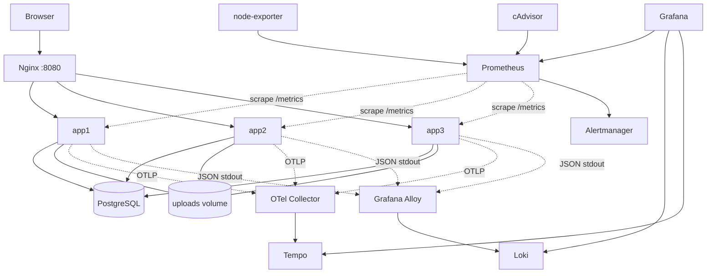
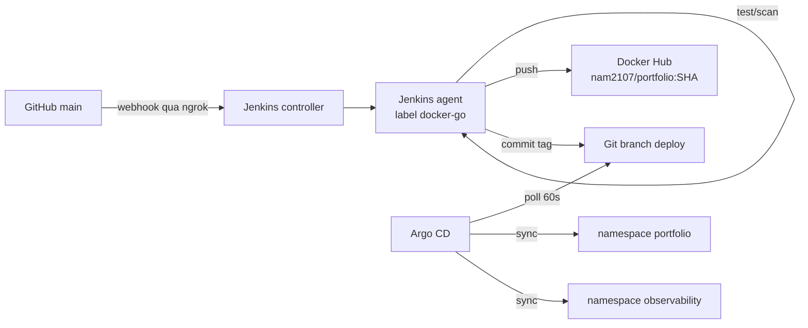

# Portfolio CRUD — Go, Docker Compose, Kubernetes, CI/CD và Observability

Portfolio CRUD là một **modular monolith** viết bằng Go, render HTML phía server (SSR) và chạy ba app instance phía sau Nginx. Repo cung cấp hai cách vận hành:

- **Docker Compose** cho môi trường homelab: app, PostgreSQL, Nginx, Jenkins, GitLab CE và stack observability.
- **Kubernetes (minikube)** cho phần app và monitoring, triển khai theo GitOps bằng **Argo CD**.

Pipeline CI/CD hiện tại: **GitHub → Jenkins (CI) → Docker Hub → Argo CD (CD)**. Jenkins chỉ build/test/scan/push image và cập nhật branch GitOps; Jenkins **không** chạy `kubectl`.

> **Trạng thái:** source, Compose config, manifest Kubernetes/Argo CD, pipeline Jenkins, unit test và integration test với PostgreSQL 18 đã được kiểm tra trong quá trình phát triển. Các bước cần credential thật (webhook GitHub, push Docker Hub, Argo CD sync) phải được kiểm tra lại trên môi trường của bạn. Xem thêm [`VERIFICATION.md`](VERIFICATION.md), lưu ý tài liệu này được tạo trong môi trường đóng gói ban đầu và có thể lỗi thời so với trạng thái hiện tại.

## 1. Tính năng

- **Public:** trang chủ, danh sách project có phân trang, chi tiết project; chỉ project `published` được công khai.
- **Admin:** đăng nhập/đăng xuất, dashboard thống kê, CRUD project, draft/published, upload/thay/xóa thumbnail.
- **Bảo mật:** Argon2id, session lưu trong PostgreSQL (chỉ lưu hash session token), CSRF, rate limit, security headers/CSP, Host allowlist, parameterized SQL, kiểm tra URL HTTPS, upload JPEG/PNG qua decode và giới hạn kích thước. App dùng database role không có quyền superuser.
- **Vận hành:** health/readiness endpoints, graceful shutdown, connection pool, container chạy non-root, Nginx load balancing.
- **Observability:** Prometheus metrics, JSON logs → Alloy → Loki, trace HTTP/DB → OTLP Collector → Tempo, Grafana provision datasource/dashboard.
- **CI/CD:** gofmt/vet, unit test, integration test với PostgreSQL thật, `govulncheck`, build image, Trivy scan, push Docker Hub, cập nhật branch `deploy`; Argo CD sync app + monitoring.

## 2. Kiến trúc

### 2.1. Runtime với Docker Compose



Compose định nghĩa **16 service mặc định** (chưa tính `jenkins-agent` ở profile `ci`):

| Nhóm | Service |
| --- | --- |
| Ứng dụng | `app1`, `app2`, `app3`, `nginx` |
| Dữ liệu | `postgres` |
| CI/CD | `jenkins`, `gitlab` |
| Observability | `grafana`, `prometheus`, `alertmanager`, `node-exporter`, `cadvisor`, `loki`, `tempo`, `otel-collector`, `alloy` |

Ngoài ra có service **`jenkins-agent`** với profile `ci`, chỉ chạy khi bật profile này. Container migration, integration test và smoke test là job tạm thời, không phải service thường trực.

> **GitLab CE** vẫn có trong Compose cho mục đích thử nghiệm nhưng **không phải CI/CD chính** của repo. Pipeline hiện tại dùng GitHub + Jenkins. Có thể bỏ service `gitlab` nếu không sử dụng.

### 2.2. CI/CD



- **Jenkins = CI.** Format, vet, unit test, database integration test, `govulncheck`, build, Trivy scan, push image. Không chạy `kubectl`.
- **Git = nguồn sự thật.** Pipeline copy manifest từ `main` sang branch `deploy` và chỉ đổi image tag.
- **Argo CD = CD duy nhất.** Nhận thay đổi từ branch `deploy`, sync cả app và monitoring.
- **Rollback** = `argocd app rollback` hoặc `git revert` commit trên branch `deploy`.

### 2.3. Kubernetes / minikube

| Application Argo CD | Đường dẫn | Namespace |
| --- | --- | --- |
| `portfolio-app` | `deploy/k8s` | `portfolio` |
| `portfolio-observability` | `deploy/k8s/observability` | `observability` |

Cả hai Application trỏ tới branch `deploy` của `https://github.com/zetasuna/portfolio.git`, bật auto-sync, self-heal và prune. Image tag app được quản lý duy nhất ở `deploy/k8s/kustomization.yaml` (`images[].newTag`), dùng chung cho container app và init container `migrate`.

### 2.4. Network và cổng host

Tất cả host port mặc định chỉ bind `127.0.0.1`.

| Service | Host port mặc định | Ghi chú |
| --- | ---: | --- |
| Website / Nginx | `8080` | Điểm truy cập website |
| `app1` | `8081` | Truy cập trực tiếp để debug |
| `app2` | `8082` | Truy cập trực tiếp để debug |
| `app3` | `8083` | Truy cập trực tiếp để debug |
| Jenkins | `8081` | **Trùng port `app1`** — xem cảnh báo bên dưới |
| Grafana | `3000` | Dashboard, cần login |
| Prometheus | `9090` | Metrics |
| Alertmanager | `9093` | Alert UI |
| Loki | `3100` | Log API |
| Tempo | Không publish | Trace API nội bộ cổng `3200` |
| OTLP | `4317` / `4318` | gRPC / HTTP |
| PostgreSQL | `5432` | Chỉ nên dùng khi debug |
| GitLab CE | `8070` / SSH `2424` | Không dùng cho pipeline hiện tại |
| cAdvisor | `8078` | Container metrics |
| node-exporter | `9100` | Host metrics |

> **Cảnh báo port:** `app1` mặc định dùng `8081`, trùng `JENKINS_HOST_PORT`. Nếu chạy Jenkins cùng lúc, đặt `APP1_HOST_PORT=18081` (hoặc đổi `JENKINS_HOST_PORT`) trong `.env` trước khi `docker compose up`.

Các network `edge_net`, `app_net`, `db_net`, `obs_net` tách service theo vai trò. Tên network thực tế theo Compose project `portfolio`, ví dụ `portfolio_db_net`, `portfolio_obs_net`.

**Đây không phải HA toàn hệ thống.** PostgreSQL, Nginx và các telemetry backend vẫn là điểm lỗi đơn. Ba app instance giúp cân bằng request và duy trì phục vụ khi một instance lỗi, không giải quyết lỗi database/host.

## 3. Yêu cầu trước khi cài

- Linux host có Docker Engine và Docker Compose v2 plugin.
- Git, `curl`, `openssl`, Python 3 (script setup dùng Python để ghi `.env`).
- Internet trong lần build đầu để tải base image và Go dependencies. Go module pin `go 1.27.0`, toolchain `go1.27.2`.
- Khuyến nghị: 6 vCPU, 16 GB RAM, SSD còn dung lượng trống. GitLab CE và stack observability khá nặng; máy nhỏ hơn nên tắt bớt service hoặc giảm retention.
- Minikube + kubectl nếu dùng phần Kubernetes.
- Tên miền/HTTPS nếu mở public. Mặc định các port chỉ bind loopback.

## 4. Quick start với Docker Compose

```bash
chmod +x scripts/*.sh
./scripts/setup.sh
```

`setup.sh` tạo `.env` với secret ngẫu nhiên cho PostgreSQL, role ứng dụng và Grafana, gán `PROJECT_DIR` bằng đường dẫn tuyệt đối và đặt permission `0600`. Script PostgreSQL init tạo role ứng dụng không có `SUPERUSER`/`CREATEDB`/`CREATEROLE` và một database riêng cho integration test.

Kiểm tra `.env` trước khi chạy:

```bash
nano .env
# Kiểm tra PROJECT_DIR, POSTGRES_USER/DB, ALLOWED_HOSTS,
# PUBLIC_BASE_URL, COOKIE_SECURE, các host port và DOCKER_GID.
```

Các lưu ý:

- `POSTGRES_PASSWORD` chỉ dùng cho bootstrap/health check; app dùng `APP_DB_*`.
- `/docker-entrypoint-initdb.d` chỉ chạy ở lần khởi tạo PostgreSQL đầu tiên. Nếu đã có volume cũ, cần provisioning role/migration thủ công hoặc dùng volume mới (xóa volume sẽ xóa dữ liệu).
- Nếu dùng Alertmanager/Telegram, tạo file `secrets/telegram_bot_token` (quyền hạn chế) hoặc bỏ mount này trong `compose.yaml` nếu không dùng. Không commit token vào Git.
- `go.sum` đã có trong repo. Chỉ chạy `go mod tidy` khi thay đổi dependency, sau đó commit cả `go.mod` và `go.sum`.

Khởi động:

```bash
./scripts/deploy.sh
# tương đương:
# docker compose config
# docker compose up -d --build
# docker compose ps
```

Chờ `app1`, `app2`, `app3`, `nginx`, `postgres` và các service observability chuyển sang `healthy`. Lần đầu có thể mất thời gian tải image và build. `app1` chạy migration trước khi serve; `app2`/`app3` chờ `app1` khỏe để tránh tranh migration ban đầu.

Tạo admin đầu tiên (mật khẩu không echo ra terminal):

```bash
./scripts/create-admin.sh
```

Truy cập:

- Website: <http://127.0.0.1:8080>
- Admin: <http://127.0.0.1:8080/admin/login>
- Grafana: <http://127.0.0.1:3000>
- Jenkins: <http://127.0.0.1:8081>

Grafana dùng `GRAFANA_ADMIN_USER` / `GRAFANA_ADMIN_PASSWORD` trong `.env`. Jenkins initial unlock password:

```bash
docker compose exec jenkins cat /var/jenkins_home/secrets/initialAdminPassword
```

## 5. Cấu hình biến môi trường

| Biến | Mục đích |
| --- | --- |
| `PROJECT_DIR` | Đường dẫn tuyệt đối tới thư mục chứa `compose.yaml`; do `setup.sh` thiết lập |
| `POSTGRES_DB`, `POSTGRES_USER`, `POSTGRES_PASSWORD` | Database chính và bootstrap administrator của PostgreSQL |
| `APP_DB_USER`, `APP_DB_PASSWORD` | Role không phải superuser cho app và integration test |
| `TEST_DB_NAME` | Database riêng cho integration test (mặc định `portfolio_test`) |
| `APP_IMAGE` | Image Compose sử dụng; mặc định `portfolio-crud:local` |
| `NGINX_HOST_PORT` / `APP_HOST_PORT` | Host port website; Compose dùng `NGINX_HOST_PORT`, một số script dùng `APP_HOST_PORT` — giữ cả hai là `8080` |
| `APP1_HOST_PORT`, `APP2_HOST_PORT`, `APP3_HOST_PORT` | Host port debug cho từng instance; mặc định `8081`/`8082`/`8083` |
| `GRAFANA_HOST_PORT`, `JENKINS_HOST_PORT` | Host port quản trị; mặc định `3000`/`8081` |
| `GRAFANA_ADMIN_USER`, `GRAFANA_ADMIN_PASSWORD` | Tài khoản Grafana |
| `SESSION_TTL` | Thời hạn session; mặc định `12h` |
| `COOKIE_SECURE` | Bật `true` sau khi TLS kết thúc tại reverse proxy tin cậy |
| `PUBLIC_BASE_URL` | Base URL public; đổi sang HTTPS origin khi deploy |
| `ALLOWED_HOSTS` | Host allowlist của app; thêm hostname thực tế nếu dùng domain |
| `TRUST_PROXY_HEADERS` | Chỉ bật khi request vào app luôn đi qua reverse proxy tin cậy |
| `OTEL_TRACES_SAMPLER_ARG` | Sampling ratio 0–1; lab mặc định `1.0` |
| `DOCKER_GID` | GID của `docker.sock` trên host để Jenkins/agent dùng được Docker daemon |
| `JENKINS_AGENT_NAME`, `JENKINS_AGENT_SECRET` | Tên node và secret của Jenkins agent |

Không đưa `.env` lên Git hoặc gắn vào log/bug report. Nếu dùng domain thật, thêm hostname **không kèm port** vào `ALLOWED_HOSTS`.

## 6. CRUD qua giao diện

1. Mở `/admin/login` và đăng nhập.
2. Tạo project với title, slug duy nhất, summary, description, technologies ngăn cách bằng dấu phẩy, GitHub/demo URL HTTPS và trạng thái.
3. Upload JPEG hoặc PNG tối đa 5 MiB; file được decode, giới hạn pixel, đặt tên ngẫu nhiên và lưu trên shared volume `uploads_data`.
4. Chọn `published` để project xuất hiện ở `/projects`; draft không được trả qua public queries.
5. Sửa project từ danh sách admin; checkbox “Remove thumbnail” để xóa ảnh hiện tại. Xóa project yêu cầu xác nhận trên browser.

Schema dùng UUID, `TEXT[]` cho technologies, unique slug và check constraints cho status/slug/độ dài. Migration nằm trong `migrations/`.

## 7. Observability

### Metrics

Prometheus scrape từng instance (`app1:8080`, `app2:8080`, `app3:8080`) trên `/metrics`; không scrape qua Nginx. Dashboard có request rate, latency histogram, HTTP 5xx/error rate, instance health và Go runtime. Alert rules mẫu theo dõi instance down và 5xx rate cao.

Ví dụ PromQL:

```promql
sum by (app_instance) (rate(http_server_requests_total[5m]))

histogram_quantile(0.95,
  sum by (le) (rate(http_server_request_duration_seconds_bucket[5m]))
)

sum(rate(http_server_requests_total{status=~"5.."}[5m]))
/
clamp_min(sum(rate(http_server_requests_total[5m])), 0.001)
```

### Logs

Go ghi JSON ra stdout/stderr. Alloy tail Docker JSON log files ở `/var/lib/docker/containers` bằng read-only mount, parse envelope và JSON fields, rồi gửi đến Loki. Không mount Docker socket vào Alloy; collector cần quyền đọc host Docker log files. Labels cố ý không dùng request ID/trace ID để tránh cardinality cao.

LogQL mẫu:

```logql
{service="portfolio-app"}
{service="portfolio-app", level="ERROR"}
{service="portfolio-app"} | json | status >= 500
```

### Traces

Go HTTP instrumentation và spans ở repository tạo trace/span. SDK gửi OTLP gRPC tới `otel-collector:4317`; Collector forward tới Tempo. Với sampling ratio `1.0` ở lab, có thể quan sát từng request. Trong Grafana chọn Tempo → Search, hoặc tra `trace_id` trong JSON log của Loki để đối chiếu.

Sau khi app chạy, tạo traffic rồi kiểm chứng:

```bash
./scripts/verify-observability.sh
```

Script kiểm tra Prometheus có `up=1` cho cả ba instance, Grafana có đủ datasource, Loki có log app và Tempo có trace. Nếu Tempo chưa có trace ở lần đầu, tạo thêm traffic, chờ export rồi chạy lại; đồng thời xem log của app/collector.

## 8. Kiểm thử

```bash
# Format, vet, unit test, race và coverage
./scripts/test.sh

# Integration test với PostgreSQL thật (cần .env và Docker)
./scripts/integration-test.sh

# Smoke test website + load balancing khi Compose đang chạy
./scripts/smoke.sh

# Acceptance: service status + smoke + observability
./scripts/acceptance.sh

# CRUD end-to-end qua HTTP, cần tài khoản admin
./scripts/curl-crud.sh
```

Ghi chú:

- `tests/integration` sẽ skip nếu không có `TEST_DATABASE_URL`. `integration-test.sh` tự tạo container Go tạm và dùng database `TEST_DB_NAME`; không chạy test này trên database chứa dữ liệu cần giữ.
- `smoke.sh` gửi 30 request và xác nhận thấy đủ header `X-App-Instance: app1`, `app2`, `app3`.
- Kiểm tra failover thủ công:

```bash
docker compose stop app2
for i in $(seq 1 10); do curl -fsS http://127.0.0.1:8080/healthz >/dev/null || exit 1; done
# 10 request vẫn thành công trong lúc app2 dừng.
docker compose start app2
./scripts/smoke.sh
```

- Compose project name là `portfolio`, nên network có dạng `portfolio_db_net` / `portfolio_obs_net`. Nếu script báo không tìm thấy network, đặt `DB_NETWORK=portfolio_db_net` hoặc cập nhật tên network tương ứng trong script.

## 9. Kubernetes / minikube

### 9.1. Bootstrap thủ công (fallback)

Dùng khi chưa cài Argo CD hoặc cần dựng lại cluster:

```bash
# App + PostgreSQL trong namespace portfolio
./scripts/k8s-deploy.sh

# Prometheus, Grafana, Loki, Tempo, OTel Collector, Alloy, cAdvisor
./scripts/k8s-monitoring-deploy.sh

# Thêm host entry (một lần)
MINIKUBE_IP="$(minikube ip)"
printf '%s portfolio.local\n%s grafana.local\n%s argocd.local\n' \
  "$MINIKUBE_IP" "$MINIKUBE_IP" "$MINIKUBE_IP" | sudo tee -a /etc/hosts
```

Truy cập:

- App: <http://portfolio.local>
- Grafana: <http://grafana.local>
- Argo CD: <http://argocd.local> (sau khi bootstrap Argo CD)

Tạo admin trong cluster:

```bash
./scripts/k8s-create-admin.sh
```

Smoke test qua ingress (dùng IP + Host header, không cần `/etc/hosts`):

```bash
SMOKE_HOST="$(minikube ip)" ./scripts/k8s-smoke.sh
```

### 9.2. Argo CD sở hữu cluster

Sau khi `./scripts/argocd-bootstrap.sh` chạy, **Argo CD là nguồn triển khai chính** cho namespace `portfolio` và `observability`. `kubectl apply -k` / `kubectl set image` chỉ dùng để bootstrap hoặc xử lý sự cố; Argo CD sẽ revert drift ở lần sync tiếp theo.

- Image tag nằm ở `deploy/k8s/kustomization.yaml` (`images:`), không sửa trực tiếp `deployment.yaml`.
- `create-admin` Job không nằm trong kustomization; `scripts/k8s-create-admin.sh` tự lấy tag từ kustomization để không lệch image.
- Secret `portfolio-db` và `grafana-admin` do `scripts/k8s-deploy.sh` / `scripts/k8s-monitoring-deploy.sh` tạo, **không** nằm trong Git. Không đưa secret vào Git nếu chưa có secret manager.

Teardown (xóa dữ liệu):

```bash
./scripts/k8s-teardown.sh app          # namespace portfolio
./scripts/k8s-teardown.sh monitoring   # namespace observability + RBAC Alloy
./scripts/k8s-teardown.sh all
```

Thêm `--disable-ingress` nếu muốn tắt ingress addon.

## 10. CI/CD: GitHub → Jenkins → Docker Hub → Argo CD

### 10.1. Branch model

- `main` là branch phát triển. CI chạy trên mọi lần push/PR.
- `deploy` là branch do `scripts/ci-gitops-bump.sh` tạo/cập nhật: mirror thư mục `deploy/` từ commit build và chỉ khác image tag.
- **Không sửa tay branch `deploy`.** Argo CD watch branch này; lần pipeline tiếp theo sẽ ghi đè từ `main`.
- Repo public nên Argo CD không cần credential đọc. Nếu chuyển private, thêm deploy key/HTTPS credential trong **Settings → Repositories** của Argo CD.

### 10.2. Cài đặt một lần

```bash
# 1. Jenkins controller + agent.
#    Trong Jenkins: Manage Jenkins -> Nodes -> New node
#      name: ci-agent, label: docker-go, remote root: /home/jenkins/agent
#    Copy secret vào .env (JENKINS_AGENT_SECRET), rồi:
./scripts/deploy_jenkins.sh

# 2. Argo CD + hai Application (tự tạo branch deploy nếu chưa có)
./scripts/argocd-bootstrap.sh

# 3. Host entry cho Argo UI
echo "$(minikube ip) argocd.local" | sudo tee -a /etc/hosts
```

Chi tiết agent: [`deploy/ci/README.md`](deploy/ci/README.md). Chi tiết Argo CD: [`deploy/argocd/README.md`](deploy/argocd/README.md).

Trước khi bootstrap Argo CD, hãy commit thay đổi. `argocd-bootstrap.sh` tạo branch `deploy` từ `HEAD` và **không** bao gồm thay đổi chưa commit.

### 10.3. Jenkins Credentials

| ID | Loại | Nội dung |
| --- | --- | --- |
| `dockerhub` | Username/password | Docker Hub username + access token (scope tối thiểu) |
| `github-gitops` | Secret text | GitHub PAT chỉ có quyền push branch `deploy` |
| `argocd-admin-password` | Secret text | Password admin Argo CD (chỉ dùng để `argocd app wait`) |

Không commit token vào repository. Token Docker Hub từng nằm trong `.gitlab-ci.yml` cũ đã bị xóa; token đó phải được **revoke** trên Docker Hub. Tương tự, không đặt bot token/chat ID trực tiếp trong file cấu hình Alertmanager; dùng secret và thu hồi token nếu từng bị commit.

### 10.4. GitHub webhook qua ngrok

```bash
ngrok http 8081 --domain=<reserved>.ngrok-free.app --basic-auth=<user>:<pass>
```

- Đặt Jenkins URL thành `https://<reserved>.ngrok-free.app`.
- GitHub → Settings → Webhooks:
  - URL: `https://<reserved>.ngrok-free.app/github-webhook/`
  - Nếu bật `--basic-auth`, dùng `https://<user>:<pass>@<reserved>.ngrok-free.app/github-webhook/`.
  - Content type: `application/json`
  - Secret: trùng với Jenkins
  - Events: `push` và `pull_request`
- Tạo **Multibranch Pipeline** trỏ tới repository.

**Cảnh báo:** Jenkins mount `/var/run/docker.sock`, gần tương đương quyền root trên host. ngrok mở toàn bộ UI Jenkins ra Internet. Bắt buộc bật basic auth, mật khẩu admin mạnh, webhook secret, tắt anonymous access; tốt hơn là đặt reverse proxy chỉ cho `/github-webhook/` hoặc dùng Cloudflare Tunnel + Access. Không expose agent port/Jenkins CLI.

### 10.5. Pipeline stages

| Stage | Nội dung |
| --- | --- |
| Checkout | `TAG=sha-<12>` |
| Format & vet | `gofmt`, `go vet` |
| Unit tests | `gotestsum`, race, coverage, JUnit |
| Database integration | PostgreSQL 18 tạm + `tests/integration` |
| Dependency scan | `govulncheck` |
| Build | `docker build --pull` |
| Image scan | Trivy: fail ở `CRITICAL`, báo cáo `HIGH` |
| Publish | Chỉ `main`; push `nam2107/portfolio:$TAG` |
| GitOps bump | Copy `deploy/` sang branch `deploy`, `kustomize edit set image` |
| Wait for Argo | `argocd app wait` cho app và monitoring |
| Smoke | `scripts/k8s-smoke.sh` qua ingress |

PR chỉ chạy CI. Publish/GitOps/deploy chỉ chạy trên `main`. Pipeline dùng `disableConcurrentBuilds()` để tránh hai lần bump chồng nhau.

### 10.6. Rollback và lưu ý vận hành

```bash
# Xem lịch sử và rollback qua Argo CD
argocd app history portfolio-app
argocd app rollback portfolio-app <history-id>

# Hoặc revert commit tag trên branch deploy
git revert <gitops-commit>
```

- Docker Hub token chỉ có scope cần thiết; không dùng mật khẩu tài khoản chính.
- Trivy có thể báo false positive; nếu chấp nhận rủi ro phải ghi lại quyết định, không tắt gate im lặng.
- Rollback image **không** rollback database migration. Migration phải tương thích ngược; migration phá hủy cần quy trình riêng.
- `create-admin` Job chạy một lần, không nằm trong kustomization.
- Alloy hiện có thể chưa ready, khiến Application `portfolio-observability` báo `Degraded`; đây là lỗi workload có sẵn, không phải lỗi sync. Kiểm tra readiness probe/log của DaemonSet Alloy trước khi dùng Argo health làm deploy gate.

## 11. HTTPS / triển khai ngoài localhost

Compose mặc định chỉ bind loopback. Để dùng public domain, nên đặt một TLS reverse proxy ở trước host/edge network, cấu hình HTTPS/HSTS sau khi TLS được kiểm chứng, đặt `COOKIE_SECURE=true`, đổi `PUBLIC_BASE_URL=https://your-domain`, thêm domain vào `ALLOWED_HOSTS`, giới hạn firewall và chỉ expose cổng 80/443. Jenkins/Grafana vẫn nên truy cập qua VPN hoặc mạng quản trị.

Không dùng `TRUST_PROXY_HEADERS=true` khi app có thể bị truy cập trực tiếp bởi client không tin cậy; rate limit lấy client IP từ `X-Real-IP` khi bật trust proxy. Đảm bảo proxy ghi đè header thay vì chuyển tiếp giá trị client tùy ý.

## 12. Backup, retention và sizing

Named volume giữ dữ liệu qua việc recreate container, **không phải backup**. Backup tối thiểu:

- PostgreSQL: `pg_dump` định kỳ.
- `uploads_data`: archive/copy thư mục upload.
- Minikube: backup PVC của `portfolio` và `observability` nếu dữ liệu quan trọng.

Test restore định kỳ. Không copy dữ liệu khi database đang ghi nếu chưa đảm bảo tính nhất quán.

Retention mặc định trong Compose:

- Prometheus: 7 ngày.
- Loki: 168 giờ / 7 ngày.
- Tempo block retention: 48 giờ.

Nếu disk/RAM tăng nhanh, xem `docker stats`, `docker system df`, retention và log size. Mỗi service còn có thể tạo log riêng qua Docker JSON log driver.

## 13. Xử lý lỗi thường gặp

**Compose báo `Set PROJECT_DIR`:** chạy `./scripts/setup.sh` trước, hoặc đảm bảo `.env` có đường dẫn tuyệt đối chính xác.

**Port `8081` đã bị chiếm:** `app1` và Jenkins mặc định cùng dùng `8081`. Đặt `APP1_HOST_PORT=18081` hoặc đổi `JENKINS_HOST_PORT` trong `.env`.

**Ứng dụng không start / `connection refused`:** xem `docker compose logs postgres app1 otel-collector`; xác minh mật khẩu PostgreSQL, readiness, DNS/network, collector và quyền volume.

**Login bị 403:** lấy form mới để nhận CSRF cookie/token; xác nhận browser nhận cookie; nếu HTTPS thì chỉ bật `COOKIE_SECURE=true` sau khi TLS proxy cấu hình đúng.

**Host bị từ chối:** thêm hostname không kèm port vào `ALLOWED_HOSTS`, sửa `PUBLIC_BASE_URL` và kiểm tra header `Host` qua Nginx.

**Image upload không lưu:** xem `docker compose logs app1`; xác minh shared `uploads_data`, quyền filesystem non-root và file thực sự là JPEG/PNG (SVG/WebP hiện không nhận).

**Prometheus target down:** kiểm tra `docker compose ps`, app health, `deploy/prometheus/prometheus.yml` và DNS tới từng app.

**Loki không thấy logs:** xem log Alloy; trên Linux xác minh Docker dùng `json-file` logging driver và log files host đọc được. Alloy dùng read-only mount của Docker log path và không hỗ trợ mọi logging driver.

**Tempo trống:** gửi HTTP traffic mới, chờ batch exporter, xem `docker compose logs app1 app2 app3 otel-collector tempo`; xác minh OTLP gRPC `4317` và network `obs_net`.

**Alertmanager không start:** kiểm tra mount `secrets/telegram_bot_token` và cấu hình receiver. Không commit token thật vào `deploy/alertmanager/alertmanager.yml`.

**Jenkins agent không start:** kiểm tra service `jenkins-agent` trong `docker compose --profile ci ps`, `JENKINS_AGENT_SECRET` trong `.env`, quyền `docker.sock` và outbound Internet. Agent phải chạy user `root` và có `host.docker.internal`/`argocd.local` trong `extra_hosts`.

**Argo CD không sync:** kiểm tra branch `deploy` đã được push chưa, `argocd app get portfolio-app`, và log `argocd-repo-server`. Nếu `portfolio-observability` báo `Degraded` do Alloy, xem readiness probe của DaemonSet đó.

**Lỗi tải Go modules:** cần outbound Internet/DNS tới module proxy ở lần đầu; đảm bảo `go.sum` đã được commit và không xóa checksum khi CI build.

**Script báo không tìm thấy network:** Compose project tên `portfolio`, nên network là `portfolio_db_net` / `portfolio_obs_net`. Đặt `DB_NETWORK=portfolio_db_net` hoặc cập nhật tên network trong script tương ứng.

## 14. Cấu trúc repo và tài liệu

```text
cmd/                     entrypoint server
internal/                handler, service, repository, auth, middleware, observability, storage
migrations/              SQL migration
web/                     HTML template và static assets
tests/integration/       integration test PostgreSQL
deploy/
  postgres/init/         tạo role ứng dụng least-privilege
  k8s/                   manifest app + PostgreSQL
  k8s/observability/     manifest Prometheus/Grafana/Loki/Tempo/OTel/Alloy
  argocd/                cài Argo CD + hai Application
  ci/                    Dockerfile Jenkins agent
  jenkins/               Dockerfile + plugins Jenkins controller
  nginx/, prometheus/, grafana/, loki/, tempo/, otel-collector/, alloy/, alertmanager/
scripts/                 setup, test, smoke, k8s, Jenkins, Argo CD, GitOps
```

Tài liệu liên quan:

- [`SECURITY.md`](SECURITY.md): phạm vi, giả định, rủi ro và hardening.
- [`VERIFICATION.md`](VERIFICATION.md): báo cáo kiểm chứng ban đầu (có thể lỗi thời).
- [`deploy/k8s/README.md`](deploy/k8s/README.md): bootstrap minikube thủ công.
- [`deploy/k8s/observability/README.md`](deploy/k8s/observability/README.md): monitoring trên minikube.
- [`deploy/argocd/README.md`](deploy/argocd/README.md): Argo CD, branch model và rollback.
- [`deploy/ci/README.md`](deploy/ci/README.md): Jenkins agent và cách đăng ký node.
